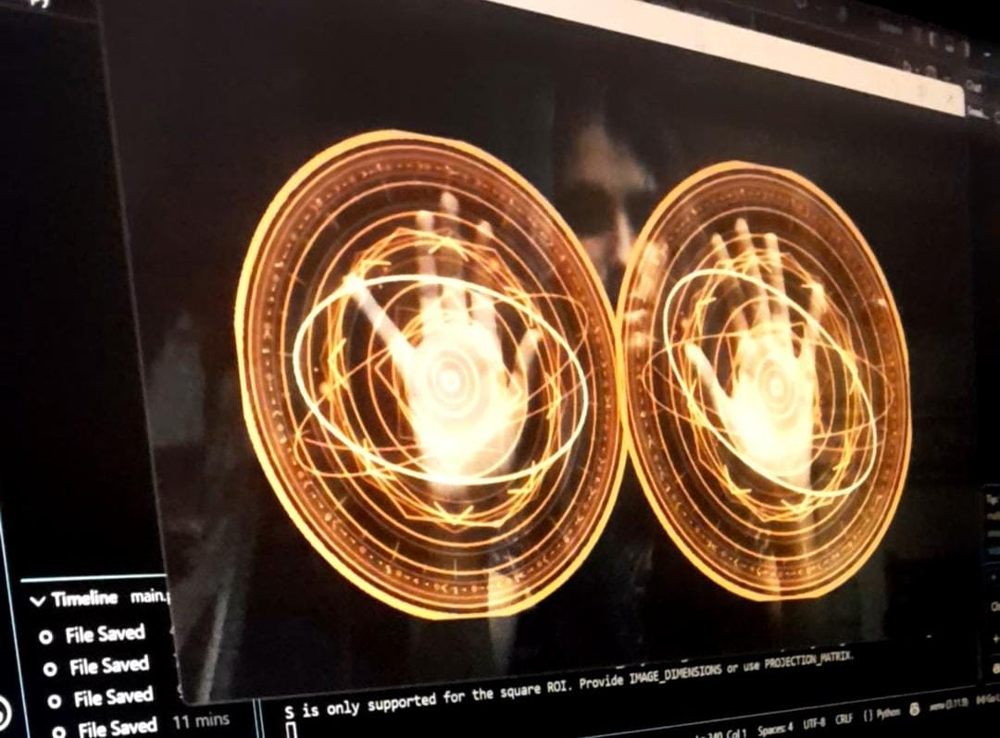

# ✨ AeroMagic

> **Real-time hand tracking and glowing mystical visual effects driven by computer vision.**

---

## 🌌 Overview

**AeroMagic** transforms natural webcam hand movements into an interactive visual experience. Built with Python, OpenCV, and MediaPipe, the application tracks hand landmarks in real time and synthesizes glowing, particle-rich mystical energy spheres that follow the user's palms.

---

## 📸 Demo Preview

---

## ⚡ Features

- **🖐️ Real-time Hand Tracking**: Sub-millisecond landmark inference powered by MediaPipe Hands.
- **✨ Mystical Sphere Synthesis**: Multi-layered amber-gold, pale-gold, and crimson visual radiance.
- **📏 Dynamic Scaling**: Dynamic sphere diameter and particle speed adjusted in real time based on apparent hand-to-camera proximity.
- **👐 Bi-manual Tracking**: Full concurrent support for both left and right hands.
- **🎯 Open-Palm Gesture Triggering**: Intelligent gesture gating using geometric landmark ratios so visual effects only trigger on intentional palm poses.

---

## 🛠️ Tech Stack & Requirements

- **Python**: 3.10 or 3.11 recommended
- **OpenCV (opencv-python)**: Video capture, frame transforms, and alpha blending
- **MediaPipe (mediapipe==0.10.21)**: 21 3D hand-landmark detection model
- **NumPy**: Vectorized color math and coordinate clamping

---

## 🚀 Getting Started

### 1. Clone the repository

`ash
git clone https://github.com/simnexis/AeroMagic.git
cd AeroMagic
`

### 2. Set up virtual environment

`powershell
python -m venv .venv
.\.venv\Scripts\Activate.ps1
`

### 3. Install dependencies

`powershell
pip install -r requirements.txt
`

### 4. Run AeroMagic

`powershell
python AeroMagic.py
`

*Ensure your webcam is connected and well-lit. Hold an open palm up to the camera to summon the sphere!*

---

## 🎮 Controls

| Key / Gesture | Action |
| :--- | :--- |
| **Open Palm** | Activates and anchors mystical sphere |
| **Closed Fist / Relaxed** | Dismisses effect gracefully |
| **Q / Esc** | Exit application cleanly |

---

## 📄 License

This project is open-source and distributed under the [MIT License](LICENSE).

---

## 👩‍💻 Author

**Simran Gupta (SIMNEXIS)**
- GitHub: [@simnexis](https://github.com/simnexis) / [@Simranroshangupta](https://github.com/Simranroshangupta)
